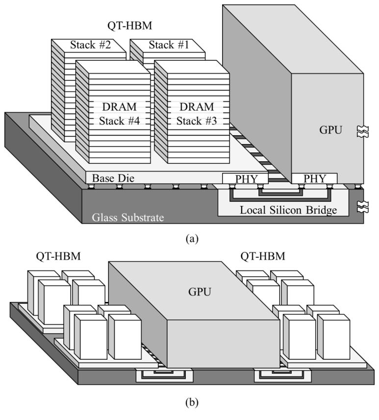
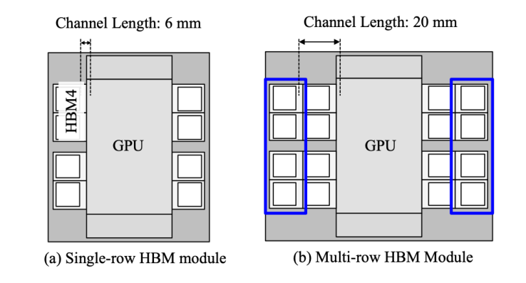

I am a PhD student in the School of Electrical and Computer Engineering at Georgia Tech, advised by Prof. Muhannad S. Bakir in the Integrated 3D Systems (I3DS) Group.

My research focuses on **advanced packaging and heterogeneous integration** for next-generation computing systems: chiplet architectures, glass-substrate-based integration, and high-bandwidth memory (HBM), with an emphasis on **signal and power integrity** analysis and design.

Before joining Georgia Tech, I received my B.S. and M.S. in Electrical Engineering from KAIST, where I worked on HBM architecture design and signal/power integrity co-analysis for 2.5D/3D integrated systems. I am a recipient of the SK hynix Global PhD Fellowship (2026), and my work has been recognized with a Best Paper Award (IEEE EDAPS 2024) and a Best Poster Award (IEEE EPEPS 2025). In Summer 2026, I was a hardware engineering intern at Cisco in San Jose, CA, working on high-speed PCIe signal integrity.

### Research topics

  

    
    
Glass-substrate memory integration

    
Multi-stack HBM architectures on glass substrates and large-area glass interposers, and the trade-offs between capacity, bandwidth, routing layers, and interconnect energy.

    
<a href="/publications/#kim2026glass3dic">3DIC 2026</a> &middot; <a href="/publications/#kim2025quadtower">EPEPS 2025</a> &middot; <a href="/publications/#kim2024twintower">EDAPS 2024</a>

  

  

    
    
Long-reach die-to-die signaling

    
Interposer architectures and channel design for chiplet links that span large advanced packages, from active interposer design-space exploration to UCIe-A mimic channels for early system validation.

    
<a href="/publications/#kim2026active">ECTC 2026</a> &middot; <a href="/publications/#kim2025ucie">ECTC 2025</a>

  

  

    
ML-assisted SI/PI design

    
Collaborative work on learning-based methods for signal and power integrity: decoupling capacitor placement, PDN impedance estimation, S-parameter generation, and eye-diagram estimation for TSV design.

    
<a href="/publications/#suh2025multichiplet">ECTC 2025</a> &middot; <a href="/publications/#an2025generative">ECTC 2025</a> &middot; <a href="/publications/#an2025stochastic">EPEPS 2025</a> &middot; <a href="/publications/#an2024eee">EPEPS 2024</a>

  

I am always happy to connect about advanced packaging, SI/PI, and hardware engineering internship opportunities. The best way to reach me is by [email](mailto:taesoo.kim@gatech.edu).

_Note: I share my name with [another Taesoo Kim at Georgia Tech](https://taesoo.kim/) who works on systems security. We are different people!_
